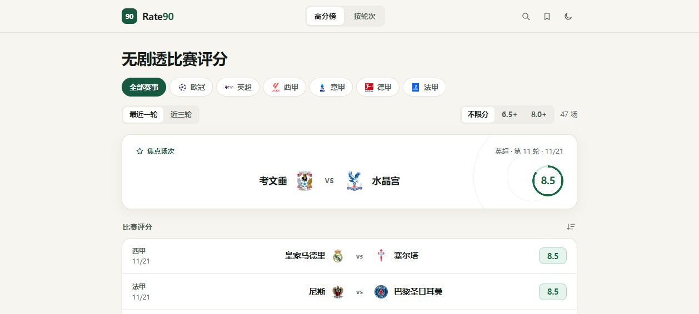
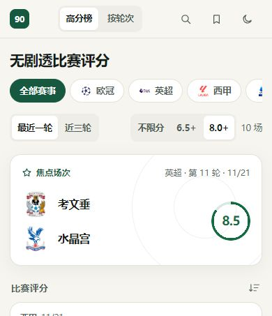
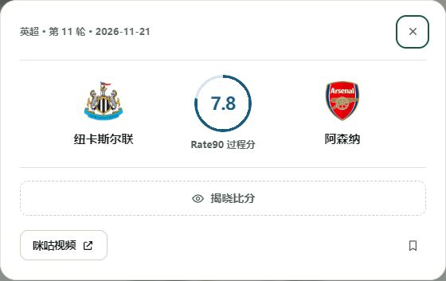
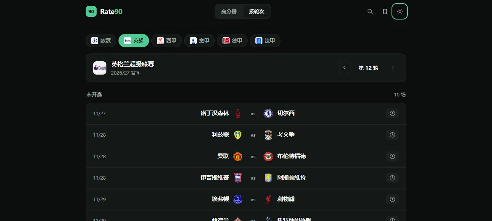
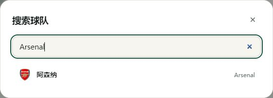
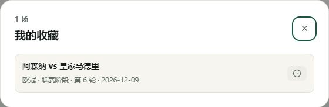

# Rate90 前端核对

2026 年 11 月 22 日，使用本地文件入口检查高分榜、轮次和比赛详情。桌面视口宽 1258 像素，窄屏检查宽 390 和 320 像素。截图均取自本次检查。

## 1. 高分榜

首页导语、重复推荐词和排序说明占用了比赛列表上方的空间。删去这些文案后，桌面首屏能完整看到焦点场和更多比赛行。最近一轮显示 47 场，切换近三轮显示 95 场。首页初次打开未加载比分文件。

## 2. 手机筛选

390 像素宽时，轮次范围、分数门槛和结果数同排。选 8.0+ 后剩 10 场。横滑选择法甲后，选中的赛事保持可见。320 像素宽时，两枚导航标签保持单行，页面无横向溢出。顶栏操作和翻轮箭头的触控区域均为 44 × 44 像素。

## 3. 比赛详情

队名各出现一次。评分下保留来源，底部保留平台名称，收藏使用书签图标。揭晓入口保留明确的动作名称。实测有过程数据的比赛可在揭晓后查看比分、六段射门次数和 xG。关闭再打开同一场会重新隐藏，读取途中退出再进入也保持隐藏。

## 4. 轮次

轮次仅在切换器显示一次，每行保留日期和对阵。实测英超从第 11 轮切到第 12 轮，显示 10 场未开赛比赛。打开未开赛详情只显示状态和平台入口等可用操作。深浅主题切换已验证。

## 5. 球队搜索

Ctrl K 打开后焦点进入输入框。输入 Arsenal 可找到阿森纳。查看球队后，通过返回箭头能回到刚才的搜索词和结果。Esc 关闭弹窗。

## 6. 收藏

实测收藏和取消收藏会同步更新详情书签状态、顶栏计数及收藏列表。空状态仅显示“暂无收藏”。

附查了 2022 世界杯归档的三场比赛、展开与收起数据、返回首页入口，以及“关于 Rate90”中从当前数据计算的 198 场收录和 95 场已评。分享按钮仅在 HTTP 入口出现，本轮未验证系统剪贴板。
